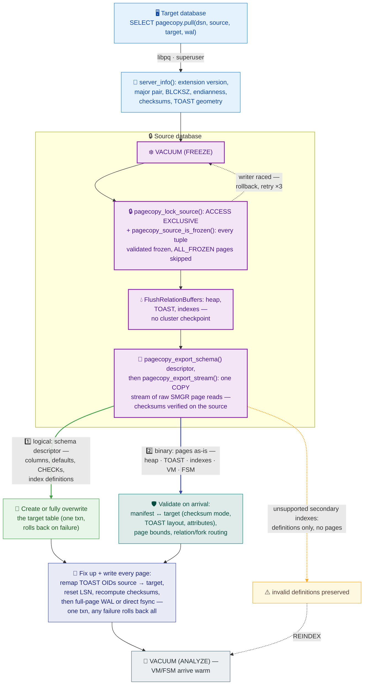

# pg_pagecopy

Copies a PostgreSQL table to another instance as ready-made data pages: heap,
TOAST, visibility maps and plain btree indexes. No row decoding. On a
~1.2 GB TOAST-heavy benchmark table it was 2.5× faster than
`COPY ... FORMAT binary` with 4.7× less CPU, and 6.2× faster than
`pg_dump -Fc`. The margin is workload-dependent: it grows with more indexes
and TOAST bloat, and shrinks on narrow heap-only tables — measure on your
own data (`docs/benchmark-results.md`).

Works on PostgreSQL 13, 14, 15, 16, 17 and 18, for same-major transfers and
all upward upgrades among those versions. Downgrades are rejected.

```sql
-- both databases
CREATE EXTENSION pg_pagecopy;

-- on the target
SELECT pagecopy.pull(
  'host=source dbname=postgres user=postgres',
  'public.events',       -- source table
  'public.events_copy'); -- target table, may not exist

VACUUM (ANALYZE) public.events_copy;
```

A missing target is created from the source schema (columns, defaults, CHECKs,
index definitions) in the same transaction, and any failure rolls everything
back.

Same database:

```sql
SELECT pagecopy.clone('public.events', 'public.events_archive');
```

`clone` shares the source xid space, so it never runs `VACUUM (FREEZE)`:
the target inherits the source freeze horizons
(`pg_class.relfrozenxid`/`relminmxid`) instead.

There is also `pagecopy.pull_server(server_name, ...)` taking a foreign
server + user mapping instead of a connection string, so credentials do not
appear in SQL, logs and `pg_stat_activity`.

Before pulling, run `pagecopy.check()` locally on the source database to
list how every index of a relation will be transferred — see
[Preflight](#preflight-pagecopycheck).

## What happens during a transfer

The big picture — the remote `pull` path (`clone` reuses the same machinery
over a loopback connection, `pull_server` differs only in the connect step):



Step by step:

1. `VACUUM (FREEZE)` runs on the source, then the table is locked `ACCESS
   EXCLUSIVE` and every tuple is validated as frozen. A racing writer aborts
   the attempt (up to 3 retries). A same-cluster `pagecopy.clone` skips this
   step: the xid space is shared, so pages keep their original xids and the
   target inherits the source freeze horizons instead.
2. `FlushRelationBuffers` flushes heap, TOAST and indexes. No cluster-wide
   checkpoint is needed.
3. Heap, TOAST, btree, visibility-map and free-space-map pages stream to the
   target as binary packets over a single libpq COPY channel. COPY is only
   the transport here — the payload is raw page images in a private format,
   no table data is decoded. Page checksums are verified on the source.
4. The target installs pages in one transaction, rewriting TOAST pointers,
   checksums and LSNs.
5. Indexes: a valid, ready plain btree with `pg_catalog` opclasses
   (partial and expression included) is copied as pages, including a btree
   backing a primary key or unique constraint. Every other source index —
   hash, GiST, GIN, BRIN, SP-GiST, invalid on source, and every exclusion
   index — arrives as a definition marked invalid: run `REINDEX` after the
   transfer, and until then uniqueness/exclusion are **not enforced**
   (recovery notes in Limits). Custom opclasses are rejected outright.

Source writers are blocked for the read window. This is a full overwrite,
not a merge. Progress: every 1024 pages a `NOTICE` fires and
`pg_stat_activity.application_name` shows
`pg_pagecopy public.events 412/1023MB 40%`.


## Preflight: `pagecopy.check`

`pagecopy.check(source_relation)` reads the current database and reports
the source-side transfer plan per relation. It takes no DSN, opens no remote
connection, and changes nothing. It reads catalogs under `AccessShareLock`,
does not read relation pages, and does not wait for ordinary
INSERT/UPDATE/DELETE writers. `pull` still revalidates the target and the
current source state before transfer: a check passing is not a guarantee that
a later pull will succeed.

Every file of the relation tree gets a row: the heap (`table`), its TOAST
chain (`toast`, `toast index`), every user index, and the `vm`/`fsm` forks of
each physically transferred object. `size` is the source file size in bytes.
Fork rows exist only while the file exists and are never copied (`method
`none``): the target starts with empty forks, so all-visible bits return only
after a target VACUUM.

- `physical` — pages copied as-is, usable right after the transfer;
- `definition` — recreated from its definition, then marked invalid
  (`indisvalid=false`, `indisready=false`) and rebuilt with `REINDEX`;
  `detail` explains why (`gist opclass pg_catalog.box_ops on box is not the
  core point_ops on point`, `invalid on source`,
  or a backing constraint);
- `error` — the source-side transfer plan is unsupported (unsafe column type,
  custom opclass, or another catalog restriction).

The first row always describes the relation itself (`type` `table`) and can
report `error` for an unsupported column type. A relation that cannot
transfer at all — view, materialized view, unlogged or partitioned table,
sequence, foreign table — yields exactly one `error` row, and `pull` fails
with the same text: one shared policy, no drift between check and transfer.
Rows are unordered, so sort by `name` for a stable listing:

```sql
-- Execute on the source database.
SELECT * FROM pagecopy.check('public.events')
ORDER BY name;
```

Example output:

```text
 name                      | type        | supported | method     | size  | detail
---------------------------+-------------+-----------+------------+-------+-----------------------------------------------------------
 events_custom             | index       | f         | error      |  8192 | custom opclasses are not supported; only pg_catalog btree opclasses are allowed
 events_gist_box             | index       | t         | definition |  8192 | gist opclass pg_catalog.box_ops on box is not the core point_ops on point
 events_key                | index       | t         | definition |  8192 | invalid on source
 events_valid              | index       | t         | physical   | 16384 |
 pg_toast.pg_toast_16401   | toast       | t         | physical   |  8192 |
 pg_toast.pg_toast_16401_index | toast index | t     | physical   |  8192 |
 public.events             | table       | t         | physical   | 24576 |
 public.events             | vm          | t         | physical   |  8192 | copied byte-identically with the relation
 public.events             | fsm         | t         | physical   | 24576 | copied byte-identically with the relation
```

## Limits

- `pagecopy.server_info()` on both sides must be compatible: it covers the
  extension version, major pair, architecture, `BLCKSZ`, alignment,
  endianness, encoding, TOAST geometry, checksums and LZ4. This is checked at
  connect; compatible results pass these physical limits automatically.
- Heap tables only: no partitions, foreign or unlogged tables, downgrades,
  differing checksum modes.
- Valid, ready btree indexes (`pg_catalog` opclasses, partial and expression
  variants) are copied as pages, as are BRIN indexes on the core fixed-width
  minmax opclasses, HASH indexes on the core int opclasses and GiST indexes
  on the core `point_ops` opclass of `point`; every other index — other
  BRIN/HASH/GiST opclasses, GIN, SP-GiST, invalid on source — arrives as an
  invalid definition to `REINDEX` yourself — until then uniqueness/exclusion
  are not enforced. Cross-major deparse drift fails closed; custom opclasses
  (contrib extensions like `btree_gist` included) are rejected. After
  transfer, `REINDEX` alone restores enforcement on an
  auto-created target; on a pre-created target re-add PK/UNIQUE with
  `ALTER TABLE ... ADD CONSTRAINT ... USING INDEX` and exclusion with
  `ADD CONSTRAINT ... EXCLUDE ...` (no `USING INDEX` for exclusion). A
  degraded replica-identity index stays designated but invalid until
  `REINDEX`. `pagecopy.check()` lists every index's mode before pulling.
- Whitelisted built-in types and arrays of them. Enums, `reg*`, OID,
  composite, range, domain and extension types are rejected. Collation
  identity must match. Fast defaults and virtual generated columns are
  rejected. Auto-created targets reject identity columns and `nextval`
  defaults. A pre-created target with a `nextval` default requires the
  sequence to be owned by the column, and its state is then advanced under
  the source lock.
- Foreign key constraints are unsupported; source-side exclusion constraints
  arrive as invalid definitions (see above). ACLs, ownership and
  roles are not transferred.
- The source connection must be a superuser, because physical export
  bypasses RLS. The target caller must own an existing target. Internal
  helpers live in `pagecopy_internal` and are revoked from `PUBLIC`.

## Index layout for contributors

See [Index layout for contributors](docs/index-layout.md).

## Build and test

```sh
make build PG_VERSION=18
make test  PG_VERSION=18
make lint  PG_VERSION=18
make bdd   PG_VERSION=17
```

`PG_CONFIG`/`PATH` selects the PostgreSQL build. The BDD suite needs Docker
and runs two postmasters in one container. Scenarios cover TOAST, btree,
overwrite, auto-creation, validation, rollback and cross-major transfers,
verified with `verify_heapam` and `bt_index_check(..., heapallindexed=true)`.

Run a tagged subset with `PG_PAGECOPY_TAGS` (comma-separated Gherkin tags;
features carry area tags like `@hash`, `@brin`, `@gist`, `@btree_extended`,
`@core`, `@validation`, and finer tags like `@recovery`, `@local`):

```sh
make bdd PG_VERSION=17 PG_PAGECOPY_TAGS=hash
```

A tagged run executes only matching scenarios and relaxes the strict
"no skipped scenarios" policy, so it is for focused iteration; untagged full
runs stay strict. Scenarios tagged `@cross` only run in cross-major runs.

## License

MIT
